# Results

Emotion recognition on **MELD dev** (1,106 clips; used for every model choice) and **MELD test**
(2,610 clips; evaluation only), and the emotion-conditioned LLM built on top of it. The main
metric is **weighted F1**, the usual MELD metric; macro F1 is reported alongside because MELD is
heavily imbalanced. Every number is a single run with seed 42
on one NVIDIA A100-SXM4-80GB. Commands are in [docs/reproduce.md](docs/reproduce.md).

- [Summary](#summary)
- [Setup](#setup)
- [Emotion models](#emotion-models)
- [Ablations](#ablations)
- [Latent space of every checkpoint](#latent-space-of-every-checkpoint)
- [Emotion-conditioned LLM](#emotion-conditioned-llm)
- [Caveats](#caveats)

## Summary

1. **No trained emotion model beats the untrained baseline on MELD test.** A kNN on frozen
   emotion2vec+ embeddings reaches **0.456** test weighted F1 (accuracy 0.476). The 17 trained
   checkpoints reach 0.442–0.458, all within ~0.01 (~26 test clips). The best dev model
   (fine-tuned, attention pooling, classification head: dev 0.444) scores 0.449 on test. Its
   dev margin was selection noise; dev was used for every model choice and test only for
   evaluation.
2. **The emotion latent is well separated on train and entangled on dev and test, for every
   checkpoint.** Training raises the train silhouette of the latent `h` from +0.17 (untrained)
   to as much as +0.58, but the dev and test silhouettes are negative for all 17 checkpoints. emotion2vec+ appears to have
   been pretrained on MELD train, so train features are unusually easy to separate.
3. **Neither attention pooling nor fine-tuning helps on test.** Fine-tuned models are slightly
   the worst on test (0.442–0.449), and attention vs mean pooling differs by ≤ 0.005.
4. **The VICReg variance/covariance terms barely matter,** except VICReg's own weighting
   (25 / 1), which hurts.
5. **Rare classes are close to unsolved:** disgust (22 dev / 68 test clips) and fear (40 / 50)
   are at 0.00–0.10 F1 everywhere.
6. **The emotion-conditioned LLM beats plain replies and uses its emotion tokens, modestly.**
   Qwen2.5-3B + soft emotion prompts, trained with SFT and GRPO, wins **73%** of held-out pairwise
   judgments on MELD test against the same model without emotion information (75% on dev). Its
   advantage shrinks when the judge is told a wrong (valence-flipped) emotion: alignment gap
   +0.04 to +0.05 on test (+0.05 to +0.08 on dev). It also beats itself fed other utterances'
   emotion features (0.53–0.54). The classification and SupCon encoders make equally good
   assistants (0.501 head to head). [Example replies](#example-replies) show where the emotion
   tokens help, and the formulaic replies they also produce.
7. **An emotion-specific GRPO reward (contrastive judge score + PMI bonus) does not pay off.** It
   makes replies more emotion-dependent but loses to plain judge-reward GRPO overall.

## Setup

| | |
|---|---|
| Data | MELD audio from the mp4 clips, 16 kHz mono. Train: 9,976 clips (13 of 9,989 dropped: 1 corrupt, 12 < 0.1 s). Dev: 1,106 (3 of 1,109 dropped: 1 missing, 2 < 0.1 s). Mean train clip 3.13 s. |
| Class counts | dev: neutral 469, joy 163, anger 152, surprise 149, sadness 111, fear 40, disgust 22. Test: neutral 1,256, joy 402, anger 345, surprise 281, sadness 208, disgust 68, fear 50 (all 2,610 test clips usable; the test folder's `._*` and `final_videos_test*` files are repeats and are not read). |
| Encoder | `emotion2vec_plus_base` (FunASR), 768-dim frames at 50 Hz. Padded batches are exact: they match FunASR's per-clip output (cos = 1.0). |
| Pooling | `mean` over valid frames, or `attention` (Linear 768→128, tanh, Linear 128→1, masked softmax; initialized to mean pooling) |
| Projector | z (768) → Linear 512 → GELU → Dropout 0.1 → Linear → D = 256 (= `h`, the latent the LLM uses) |
| Heads | **Classification:** Dropout 0.1 + Linear 256→7, cross-entropy with inverse-sqrt class weights and label smoothing 0.1. **SupCon:** τ = 0.1 on the L2-normalized `h`, + 1.0·L_var (γ = 1) + 0.04·L_cov on the raw `h`. |
| Frozen pipelines | Train on cached features (z for mean pooling, frames for attention). Classification: 50 epochs, batch 128. SupCon: 100 epochs, class-balanced batches of 7 × 32. AdamW, lr 1e-3, 2 warmup epochs + cosine. |
| Fine-tuning | CNN front end frozen; transformer at lr 2e-5, heads + pooler at 1e-3; heads only for epoch 1. 10 epochs, bf16, 8 s random crops. Classification: length-bucketed batches of 32. SupCon: class-balanced batches of 7 × 16. |
| Model selection | Best dev epoch, by the head's weighted F1 (classification) or a cosine kNN, k = 20, T = 0.07, against the train set (SupCon). SupCon also fits a logistic-regression probe on the best checkpoint. |

### Model size and compute

| Component | Params | Trainable (frozen / fine-tuned) | Forward FLOPs |
|---|---|---|---|
| emotion2vec+ base | 93.80M (93.17M used; pretraining decoder and 9-class head unused) | 0 / 88.96M (CNN front end, 4.21M, stays frozen) | **15.43 GFLOPs per s of audio**; 45.8 GFLOPs per mean 3.13 s clip |
| Attention pooler | 98,561 | all | 9.7 MFLOPs per s of audio |
| Projector (768→512→256) | 525,056 | all | 1.05 MFLOPs per clip |
| Classifier (256→7) / linear probe | 1,799 | all | ~3.6 KFLOPs |
| **Full model** | 94.3M (mean) / 94.4M (attention) | 0.53–0.63M / 89.5–89.6M | ≈ 15.4 GFLOPs per s of audio (> 99.9% in the encoder) |

FLOPs come from `torch.utils.flop_counter` (one multiply-add = 2 FLOPs). Training compute is
estimated as 3× forward for trained modules plus 1× for frozen modules run in the loop:
≈ 13 PFLOPs per 10-epoch fine-tune and 1.6–95 TFLOPs for the frozen pipelines.

## Emotion models

Default configs with `pooling.type` overridden. For SupCon, scores are kNN (used for model
selection) / linear probe.

**How dev and test are used.**
- **Dev selects:** every choice — best epoch, pooling, loss weights — was made on dev.
- **Test only evaluates:** the selected checkpoints were scored on MELD test (2,610 clips) once,
  with nothing tuned on it.
- **Refit probes:** frozen SupCon runs and classification runs never saved their linear probe,
  so their test probe is refit on train exactly as in training. On dev, this reproduces the
  saved numbers to ±0.001.

Re-running the 8 configurations reproduced every dev number to three decimals.

| Experiment | Pipeline | Pooling | Dev weighted F1 | Dev macro F1 | **Test weighted F1** | **Test macro F1** | Best / total epochs | Train min | Train clips/s | Peak GPU GB |
|---|---|---|---|---|---|---|---|---|---|---|
| — | **kNN on untrained emotion2vec+ z** | mean | 0.427 | 0.282 | **0.456** | 0.269 | – | 0 | – | – |
| `main_frozen_cls_mean` | Frozen + classification | mean | 0.427 | 0.286 | 0.449 | **0.277** | 29 / 50 | 0.2 | 36,481 | < 0.1 |
| `main_frozen_cls_attention` | Frozen + classification | attention | 0.427 | 0.289 | 0.445 | 0.272 | 10 / 50 | 3.2 | 2,552 | 0.6 |
| `main_frozen_supcon_mean` | Frozen + SupCon | mean | 0.436 / 0.437 | 0.291 / 0.291 | 0.455 / 0.454 | 0.274 / 0.275 | 39 / 100 | 0.5 | 31,987 | < 0.1 |
| `main_frozen_supcon_attention` | Frozen + SupCon | attention | 0.432 / 0.432 | 0.286 / 0.281 | 0.454 / 0.450 | 0.274 / 0.271 | 2 / 100 | 7.6 | 2,177 | 1.2 |
| `main_finetune_cls_mean` | Fine-tuned + classification | mean | 0.434 | 0.282 | 0.448 | 0.269 | 3 / 10 | 5.0 | 335 | 19.7 |
| `main_finetune_cls_attention` | Fine-tuned + classification | attention | **0.444** | **0.293** | 0.449 | 0.266 | 3 / 10 | 5.0 | 330 | 19.7 |
| `main_finetune_supcon_mean` | Fine-tuned + SupCon | mean | **0.443** / 0.435 | 0.284 / 0.274 | 0.446 / 0.449 | 0.264 / 0.268 | 6 / 10 | 10.6 | 157 | 46.3 |
| `main_finetune_supcon_attention` | Fine-tuned + SupCon | attention | 0.434 / 0.428 | 0.278 / 0.276 | 0.442 / 0.445 | 0.262 / 0.266 | 7 / 10 | 10.7 | 156 | 46.3 |

**Reading the table**
- **On test, nothing beats the untrained baseline.**
  - kNN on frozen emotion2vec+ embeddings reaches 0.456 weighted F1 (accuracy 0.476).
  - Every trained model lands at 0.442–0.455.
  - The fine-tuned models, best on dev, are now slightly the *worst*.
  - All differences are within ~0.01 (~26 test clips), so the honest conclusion is: **no
    training recipe here improves on the frozen emotion2vec+ features for MELD audio.**
- **Dev margins don't survive.** Fine-tuning's dev gain (+0.017) is selection noise plus
  overfitting to train (see the latent-space section).
- **Test scores are higher than dev for every model** (0.44–0.46 vs 0.43–0.44). The splits differ
  in difficulty and class mix; for example, test is 48% neutral vs dev's 42%.
- **Frozen attention runs are slower** because they train on cached frame features (≈ 156 frames
  per clip) instead of one vector per clip.
- **Fine-tuning** costs 5–11 min per run vs 0.2–0.5 min for frozen mean-pooled runs, for no gain
  on test.

### Per-class F1

For SupCon, the linear-probe predictions.

| Pipeline | Pooling | Split | neutral | joy | surprise | anger | sadness | disgust | fear |
|---|---|---|---|---|---|---|---|---|---|
| kNN on untrained z | mean | dev | 0.612 | 0.302 | 0.282 | 0.403 | 0.260 | 0.067 | 0.044 |
|  |  | test | 0.644 | 0.319 | 0.333 | 0.311 | 0.231 | 0.048 | 0.000 |
| Frozen + classification | mean | dev | 0.597 | 0.326 | 0.307 | 0.386 | 0.277 | 0.035 | 0.074 |
|  |  | test | 0.616 | 0.324 | 0.338 | 0.322 | 0.278 | 0.040 | 0.023 |
| Frozen + classification | attention | dev | 0.601 | 0.326 | 0.305 | 0.399 | 0.240 | 0.086 | 0.066 |
|  |  | test | 0.616 | 0.328 | 0.335 | 0.308 | 0.253 | 0.036 | 0.031 |
| Frozen + SupCon (probe) | mean | dev | 0.621 | 0.327 | 0.300 | 0.399 | 0.267 | 0.048 | 0.075 |
|  |  | test | 0.634 | 0.319 | 0.341 | 0.314 | 0.243 | 0.051 | 0.021 |
| Frozen + SupCon (probe) | attention | dev | 0.616 | 0.310 | 0.302 | 0.414 | 0.243 | 0.000 | 0.078 |
|  |  | test | 0.633 | 0.305 | 0.330 | 0.310 | 0.255 | 0.040 | 0.024 |
| Fine-tuned + classification | mean | dev | 0.637 | 0.305 | 0.306 | 0.357 | 0.252 | 0.051 | 0.066 |
|  |  | test | 0.642 | 0.301 | 0.326 | 0.304 | 0.177 | 0.077 | 0.057 |
| Fine-tuned + classification | attention | dev | 0.638 | 0.309 | 0.321 | 0.381 | 0.289 | 0.051 | 0.065 |
|  |  | test | 0.645 | 0.297 | 0.344 | 0.301 | 0.179 | 0.075 | 0.019 |
| Fine-tuned + SupCon (probe) | mean | dev | 0.625 | 0.338 | 0.337 | 0.358 | 0.260 | 0.000 | 0.000 |
|  |  | test | 0.634 | 0.337 | 0.310 | 0.305 | 0.206 | 0.059 | 0.026 |
| Fine-tuned + SupCon (probe) | attention | dev | 0.622 | 0.315 | 0.302 | 0.345 | 0.271 | 0.000 | 0.078 |
|  |  | test | 0.633 | 0.332 | 0.304 | 0.285 | 0.212 | 0.040 | 0.051 |

On test, sadness is clearly worse for the fine-tuned models (0.18–0.21 vs 0.24–0.28 frozen), and
disgust and fear stay near zero everywhere (68 and 50 test clips).

## Ablations

SupCon variance/covariance weights (frozen encoder, mean pooling, 30 epochs) and short SupCon
fine-tunes, as kNN / linear-probe weighted F1 and macro F1. Test probes for the frozen runs are
refit on train.

| Experiment | Change from the default config | Best / total epochs | Train min | Dev kNN w / macro F1 | Dev probe w / macro F1 | **Test kNN** w / macro F1 | **Test probe** w / macro F1 |
|---|---|---|---|---|---|---|---|
| `ablation_frozen_supcon_plain_100ep` | SupCon without var/cov, 100 epochs | 1 / 100 | 0.5 | 0.436 / 0.282 | 0.440 / 0.287 | 0.455 / 0.272 | 0.449 / 0.272 |
| `sweep_var0_cov0` | var / cov weights 0 / 0 | 1 / 30 | 0.2 | 0.436 / 0.282 | 0.440 / 0.287 | 0.455 / 0.272 | 0.449 / 0.272 |
| `sweep_var1_cov0.04` | 1 / 0.04 (the default) | 18 / 30 | 0.2 | 0.433 / 0.295 | 0.431 / 0.285 | 0.453 / 0.271 | 0.457 / 0.279 |
| `sweep_var1_cov0.2` | 1 / 0.2 | 20 / 30 | 0.2 | 0.432 / 0.281 | 0.436 / 0.289 | 0.454 / 0.270 | 0.457 / 0.279 |
| `sweep_var5_cov0.2` | 5 / 0.2 | 21 / 30 | 0.2 | 0.435 / 0.290 | 0.432 / 0.286 | 0.454 / 0.274 | 0.455 / 0.276 |
| `sweep_var25_cov1` | 25 / 1 (VICReg's weights) | 14 / 30 | 0.2 | 0.432 / 0.279 | **0.419 / 0.251** | 0.458 / 0.271 | **0.444 / 0.237** |
| `ablation_finetune_supcon_plain_3ep` | fine-tuned SupCon without var/cov, 3 epochs | 3 / 3 | 2.8 | 0.434 / **0.305** | 0.429 / 0.289 | 0.451 / 0.268 | 0.451 / 0.268 |
| `ablation_finetune_supcon_varcov_2ep` | fine-tuned SupCon, encoder trained from epoch 1, 2 epochs | 2 / 2 | 2.3 | 0.431 / 0.282 | 0.430 / 0.287 | 0.449 / 0.263 | 0.449 / 0.265 |
| `ablation_finetune_supcon_varcov_1ep` | same, 1 epoch | 1 / 1 | 1.1 | 0.430 / 0.289 | 0.431 / 0.287 | 0.453 / 0.266 | 0.452 / 0.265 |

- **Frozen SupCon without var/cov peaks after one epoch,** so the 100-epoch run and the 0 / 0 sweep
  point are the same checkpoint.
- **The sweep spans 0.453–0.458 (kNN) on test, as tight as on dev.** The one consistent effect,
  on both dev and test, is that VICReg's own weighting compresses the latent (train Fisher ratio
  0.20 vs ~0.5) and hurts the probe, with sadness F1 dropping to 0.17 and disgust and fear to 0.
- **The dev macro-F1 lead of the 3-epoch SupCon fine-tune (0.305) does not hold on test** (0.268).

## Latent space of every checkpoint

`scripts/emotion/plot_latent_space.py` embeds train, dev and test with each checkpoint (`z` =
pooled 768-d embedding, `h` = 256-d projector latent). PCA and LDA are fit on train and applied
unchanged to dev and test; t-SNE runs per split. Class separation is measured in the full feature space,
standardized with train statistics:
- **silhouette:** cosine distance, on a fixed 4,000-point subsample per split; above 0 means
  the classes form clusters, below 0 means they are mixed;
- **Fisher ratio:** between-class / within-class scatter;
- **kNN and linear-probe weighted F1:** fit on train, evaluated on dev and on test;
- **centroid cosine:** mean cosine similarity between the 7 class centroids of dev / test (lower =
  more separated).

In the figures, rows are train / dev / test; each panel shows one emotion (blue) over all other
points (gray), and the first panel of each row marks the class centroids.

### Separation metrics

Silhouette and Fisher ratio are given as train / dev / test. Above 0 means the classes form
clusters; below 0 means they are mixed. kNN, probe and centroid columns are evaluated on dev and
test; everything is fit on train.

| Checkpoint | `h` silhouette | `h` Fisher | `h` kNN dev / test | `h` probe dev / test | `h` centroid cos dev / test | `z` silhouette | `z` Fisher |
|---|---|---|---|---|---|---|---|
| untrained emotion2vec+ (`raw` z) | – | – | 0.424 / 0.456 (raw z) | 0.427 / 0.454 (raw z) | +0.17 / +0.16 | +0.171 / −0.070 / −0.056 | 0.498 / 0.076 / 0.053 |
| `main_frozen_cls_mean` | +0.229 / −0.065 / −0.054 | 0.644 / 0.087 / 0.065 | 0.434 / 0.451 | 0.431 / 0.456 | +0.00 / −0.00 | = raw | = raw |
| `main_frozen_supcon_mean` | +0.170 / −0.062 / −0.059 | 0.448 / 0.057 / 0.047 | 0.426 / 0.447 | 0.437 / 0.453 | +0.11 / +0.10 | = raw | = raw |
| `main_finetune_cls_mean` | +0.472 / −0.060 / −0.053 | 1.551 / 0.109 / 0.077 | 0.436 / 0.441 | 0.434 / 0.447 | +0.03 / −0.01 | +0.316 / −0.068 / −0.054 | 0.818 / 0.082 / 0.053 |
| `main_finetune_supcon_mean` | +0.549 / −0.069 / −0.057 | 1.892 / 0.088 / 0.060 | 0.442 / 0.440 | 0.428 / 0.452 | +0.12 / +0.12 | +0.445 / −0.071 / −0.059 | 1.175 / 0.083 / 0.056 |
| `main_frozen_cls_attention` | +0.218 / −0.066 / −0.060 | 0.687 / 0.093 / 0.073 | 0.429 / 0.449 | 0.434 / 0.456 | −0.02 / −0.04 | +0.173 / −0.074 / −0.058 | 0.483 / 0.076 / 0.055 |
| `main_frozen_supcon_attention` | +0.174 / −0.082 / −0.072 | 0.584 / 0.087 / 0.066 | 0.420 / 0.455 | 0.436 / 0.455 | +0.18 / +0.19 | +0.167 / −0.076 / −0.061 | 0.502 / 0.076 / 0.055 |
| **`main_finetune_cls_attention`** | +0.477 / −0.060 / −0.054 | 1.571 / 0.110 / 0.076 | 0.437 / 0.445 | 0.439 / 0.449 | +0.05 / +0.01 | +0.345 / −0.069 / −0.056 | 0.827 / 0.086 / 0.058 |
| `main_finetune_supcon_attention` | +0.584 / −0.068 / −0.058 | 1.946 / 0.076 / 0.050 | 0.433 / 0.438 | 0.434 / 0.442 | +0.11 / +0.13 | +0.480 / −0.079 / −0.067 | 1.331 / 0.073 / 0.051 |
| `ablation_frozen_supcon_plain_100ep` | +0.138 / −0.089 / −0.070 | 0.533 / 0.089 / 0.062 | 0.421 / 0.453 | 0.430 / 0.453 | +0.24 / +0.28 | = raw | = raw |
| `sweep_var0_cov0` | +0.138 / −0.089 / −0.070 | 0.533 / 0.089 / 0.062 | 0.421 / 0.453 | 0.430 / 0.453 | +0.24 / +0.28 | = raw | = raw |
| `sweep_var1_cov0.04` | +0.176 / −0.069 / −0.060 | 0.517 / 0.068 / 0.053 | 0.434 / 0.449 | 0.431 / 0.460 | +0.08 / +0.07 | = raw | = raw |
| `sweep_var1_cov0.2` | +0.150 / −0.063 / −0.055 | 0.410 / 0.055 / 0.045 | 0.429 / 0.445 | 0.433 / 0.457 | +0.11 / +0.09 | = raw | = raw |
| `sweep_var5_cov0.2` | +0.179 / −0.069 / −0.060 | 0.560 / 0.067 / 0.054 | 0.425 / 0.449 | 0.433 / 0.455 | +0.07 / +0.08 | = raw | = raw |
| `sweep_var25_cov1` | +0.098 / −0.047 / −0.044 | 0.203 / 0.037 / 0.026 | 0.428 / 0.454 | 0.426 / 0.458 | +0.16 / +0.14 | = raw | = raw |
| `ablation_finetune_supcon_plain_3ep` | +0.287 / −0.100 / −0.073 | 0.853 / 0.082 / 0.058 | 0.427 / 0.449 | 0.438 / 0.451 | +0.39 / +0.41 | +0.277 / −0.069 / −0.054 | 0.719 / 0.076 / 0.052 |
| `ablation_finetune_supcon_varcov_2ep` | +0.349 / −0.086 / −0.062 | 1.103 / 0.091 / 0.065 | 0.421 / 0.452 | 0.421 / 0.451 | +0.16 / +0.18 | +0.299 / −0.070 / −0.056 | 0.814 / 0.083 / 0.057 |
| `ablation_finetune_supcon_varcov_1ep` | +0.280 / −0.075 / −0.061 | 0.875 / 0.093 / 0.069 | 0.432 / 0.455 | 0.428 / 0.456 | +0.13 / +0.17 | +0.257 / −0.069 / −0.058 | 0.731 / 0.088 / 0.064 |

("= raw": in frozen mean-pooled runs, `z` is the untrained embedding itself.)

- **Train separation grows with training; held-out separation barely moves.** Fine-tuning roughly
  triples the train Fisher ratio of `h` (0.5 → 1.5–1.95) and the train silhouette (+0.17 →
  +0.47–0.58). On dev and test the silhouette stays negative everywhere, and the test Fisher ratio
  moves from 0.053 (untrained) to at most 0.077.
- **More train separation does not mean better held-out separation.**
  `main_finetune_supcon_attention` has the most separated train latent, yet its test Fisher ratio
  (0.050) is below the untrained embedding's (0.053). Its LDA plot shows train fear and disgust pushed onto
  far-away arms of their own, while dev and test collapse into a single blob.
- **Classification-trained latents separate classes best on held-out data** (test Fisher
  0.073–0.077 for `main_frozen_cls_attention` and the fine-tuned classifiers, dev up to 0.110).
  They also keep class centroids apart (test cosine −0.04 to +0.01). This does not translate into
  better held-out classification: kNN and probe scores stay at 0.44–0.46, the same as untrained.
- **VICReg's weighting (25 / 1) compresses the class structure** (Fisher ratio 0.20 / 0.037 /
  0.026). Its held-out silhouettes are the least negative only because the whole space shrinks.

### Figures

The untrained emotion2vec+ embedding, the reference every checkpoint starts from (LDA):

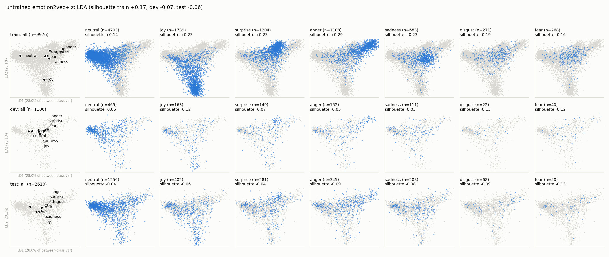

[PCA](docs/figures/latent/main_frozen_cls_mean/raw_pca.png) ·
[t-SNE](docs/figures/latent/main_frozen_cls_mean/raw_tsne.png)

Each checkpoint below shows the LDA projection of `h`, the latent the LLM consumes. LDA is fit
on train and applied to dev, so it shows the best linear 2-D separation and whether it
transfers. The links give the other projections, `z`, and the dev and test centroid-similarity
heatmaps.

<b>Fine-tuned encoders</b> (4 checkpoints)

**`main_finetune_cls_attention`** (best model, dev weighted F1 0.444)

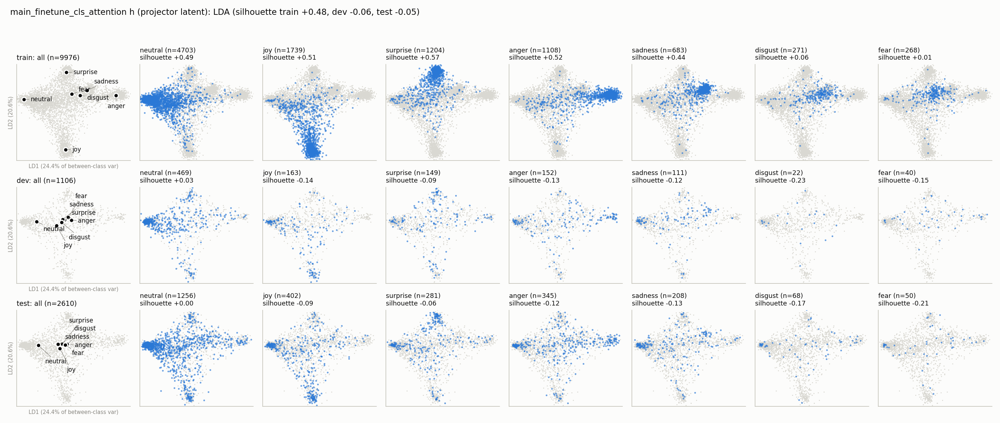

[h PCA](docs/figures/latent/main_finetune_cls_attention/h_pca.png) · [h t-SNE](docs/figures/latent/main_finetune_cls_attention/h_tsne.png) · [z LDA](docs/figures/latent/main_finetune_cls_attention/z_lda.png) · [z PCA](docs/figures/latent/main_finetune_cls_attention/z_pca.png) · [z t-SNE](docs/figures/latent/main_finetune_cls_attention/z_tsne.png) · [centroid similarity dev](docs/figures/latent/main_finetune_cls_attention/centroid_similarity.png) · [test](docs/figures/latent/main_finetune_cls_attention/centroid_similarity_test.png)

**`main_finetune_cls_mean`** (0.434)

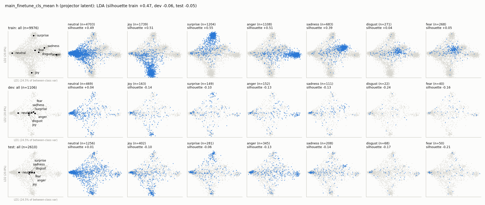

[h PCA](docs/figures/latent/main_finetune_cls_mean/h_pca.png) · [h t-SNE](docs/figures/latent/main_finetune_cls_mean/h_tsne.png) · [z LDA](docs/figures/latent/main_finetune_cls_mean/z_lda.png) · [z PCA](docs/figures/latent/main_finetune_cls_mean/z_pca.png) · [z t-SNE](docs/figures/latent/main_finetune_cls_mean/z_tsne.png) · [centroid similarity dev](docs/figures/latent/main_finetune_cls_mean/centroid_similarity.png) · [test](docs/figures/latent/main_finetune_cls_mean/centroid_similarity_test.png)

**`main_finetune_supcon_mean`** (kNN 0.443)

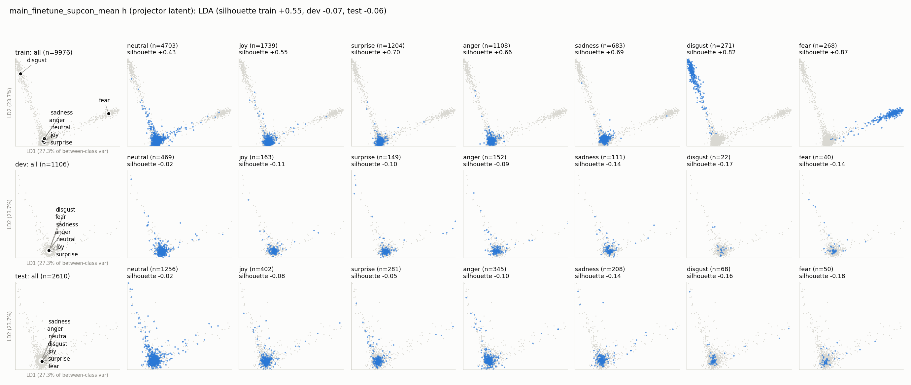

[h PCA](docs/figures/latent/main_finetune_supcon_mean/h_pca.png) · [h t-SNE](docs/figures/latent/main_finetune_supcon_mean/h_tsne.png) · [z LDA](docs/figures/latent/main_finetune_supcon_mean/z_lda.png) · [z PCA](docs/figures/latent/main_finetune_supcon_mean/z_pca.png) · [z t-SNE](docs/figures/latent/main_finetune_supcon_mean/z_tsne.png) · [centroid similarity dev](docs/figures/latent/main_finetune_supcon_mean/centroid_similarity.png) · [test](docs/figures/latent/main_finetune_supcon_mean/centroid_similarity_test.png)

**`main_finetune_supcon_attention`** (kNN 0.434; most separated train latent)

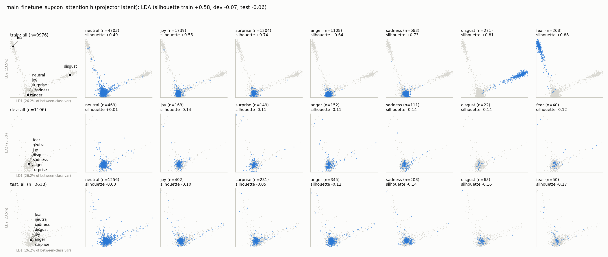

[h PCA](docs/figures/latent/main_finetune_supcon_attention/h_pca.png) · [h t-SNE](docs/figures/latent/main_finetune_supcon_attention/h_tsne.png) · [z LDA](docs/figures/latent/main_finetune_supcon_attention/z_lda.png) · [z PCA](docs/figures/latent/main_finetune_supcon_attention/z_pca.png) · [z t-SNE](docs/figures/latent/main_finetune_supcon_attention/z_tsne.png) · [centroid similarity dev](docs/figures/latent/main_finetune_supcon_attention/centroid_similarity.png) · [test](docs/figures/latent/main_finetune_supcon_attention/centroid_similarity_test.png)

<b>Frozen encoders</b> (4 checkpoints; only the pooler and projector train)

**`main_frozen_cls_mean`** (0.427)

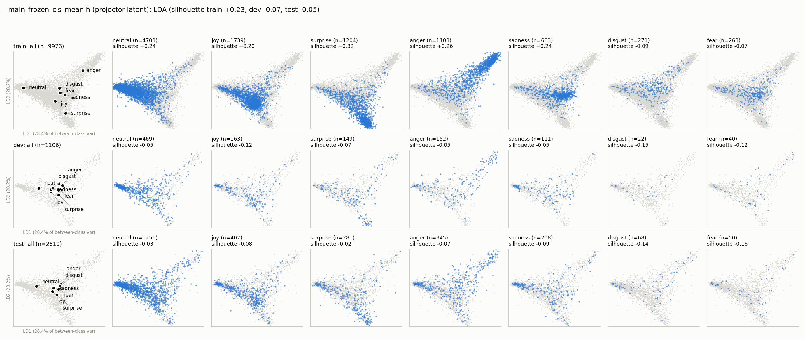

[h PCA](docs/figures/latent/main_frozen_cls_mean/h_pca.png) · [h t-SNE](docs/figures/latent/main_frozen_cls_mean/h_tsne.png) · [centroid similarity dev](docs/figures/latent/main_frozen_cls_mean/centroid_similarity.png) · [test](docs/figures/latent/main_frozen_cls_mean/centroid_similarity_test.png)

**`main_frozen_cls_attention`** (0.427)

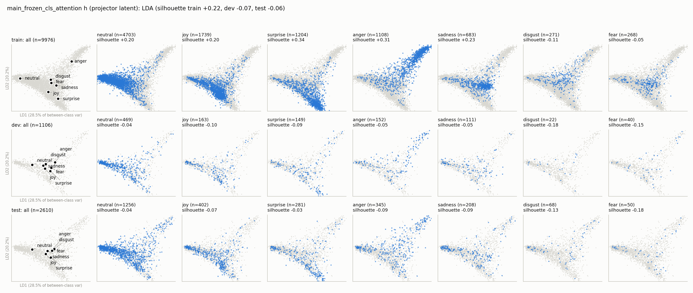

[h PCA](docs/figures/latent/main_frozen_cls_attention/h_pca.png) · [h t-SNE](docs/figures/latent/main_frozen_cls_attention/h_tsne.png) · [z LDA](docs/figures/latent/main_frozen_cls_attention/z_lda.png) · [centroid similarity dev](docs/figures/latent/main_frozen_cls_attention/centroid_similarity.png) · [test](docs/figures/latent/main_frozen_cls_attention/centroid_similarity_test.png)

**`main_frozen_supcon_mean`** (kNN 0.436)

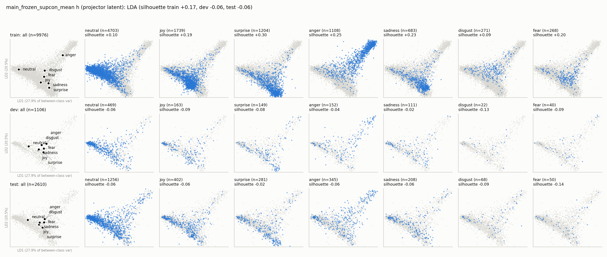

[h PCA](docs/figures/latent/main_frozen_supcon_mean/h_pca.png) · [h t-SNE](docs/figures/latent/main_frozen_supcon_mean/h_tsne.png) · [centroid similarity dev](docs/figures/latent/main_frozen_supcon_mean/centroid_similarity.png) · [test](docs/figures/latent/main_frozen_supcon_mean/centroid_similarity_test.png)

**`main_frozen_supcon_attention`** (kNN 0.432)

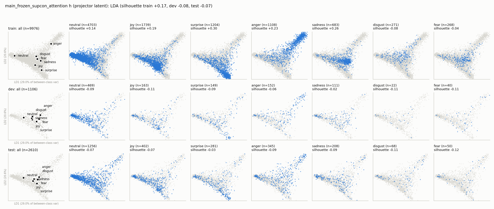

[h PCA](docs/figures/latent/main_frozen_supcon_attention/h_pca.png) · [h t-SNE](docs/figures/latent/main_frozen_supcon_attention/h_tsne.png) · [z LDA](docs/figures/latent/main_frozen_supcon_attention/z_lda.png) · [centroid similarity dev](docs/figures/latent/main_frozen_supcon_attention/centroid_similarity.png) · [test](docs/figures/latent/main_frozen_supcon_attention/centroid_similarity_test.png)

<b>Ablations</b> (9 checkpoints)

**`ablation_frozen_supcon_plain_100ep`** (same checkpoint as `sweep_var0_cov0`)

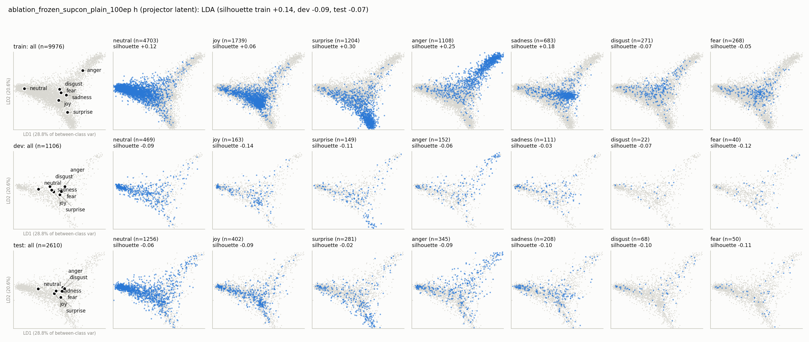

**`sweep_var1_cov0.04`** (default weights)

**`sweep_var1_cov0.2`**

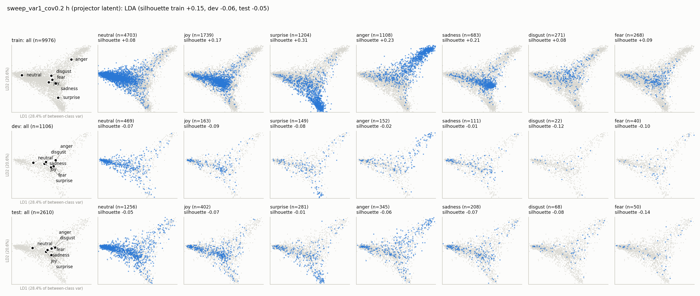

**`sweep_var5_cov0.2`**

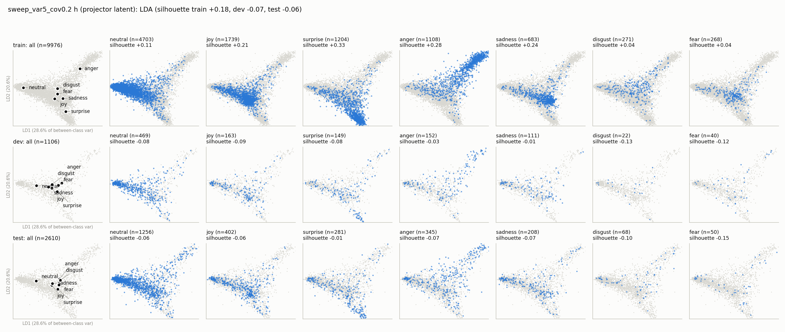

**`sweep_var25_cov1`** (VICReg's weights: compressed latent)

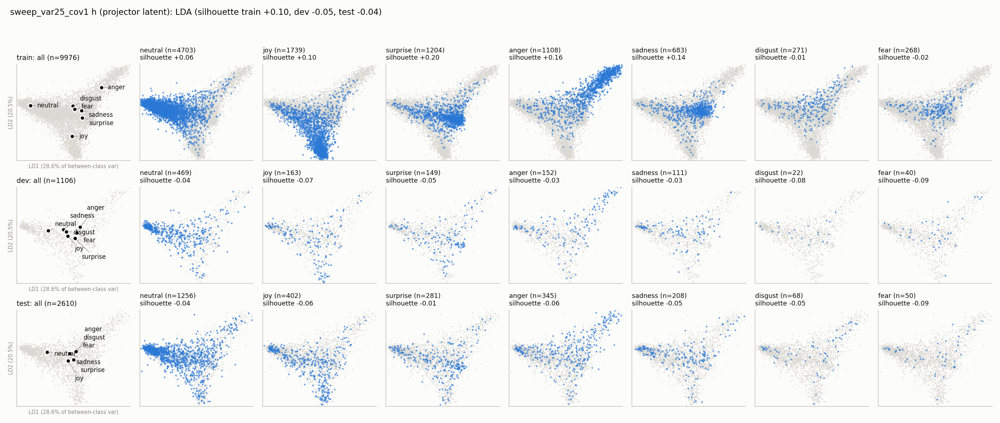

**`ablation_finetune_supcon_plain_3ep`** (best macro F1, 0.305)

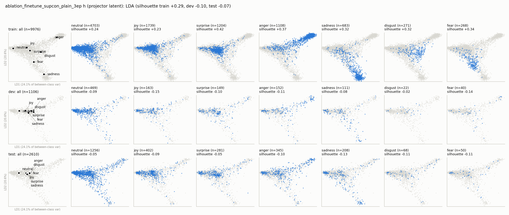

**`ablation_finetune_supcon_varcov_2ep`**

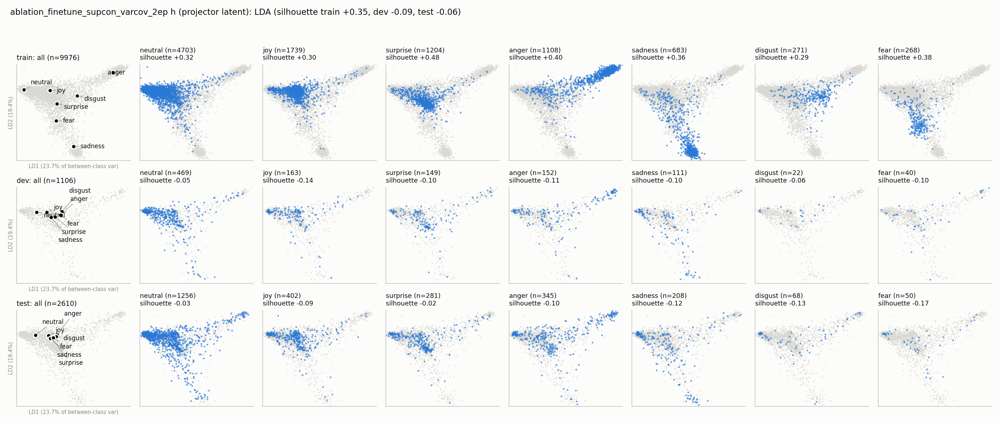

**`ablation_finetune_supcon_varcov_1ep`**

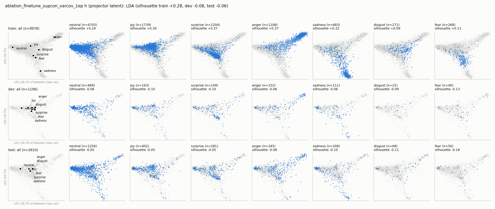

`sweep_var0_cov0`: [h LDA](docs/figures/latent/sweep_var0_cov0/h_lda.png). Every checkpoint's
PCA, t-SNE, `z` and centroid figures are in `docs/figures/latent/<experiment>/`.

## Emotion-conditioned LLM

Two policies, one per frozen emotion model:
- **cls:** `main_finetune_cls_attention` (fine-tuned, attention pooling, classification head);
- **supcon:** `main_finetune_supcon_attention` (fine-tuned, attention pooling, SupCon; its
  predicted emotions come from its linear probe).

Each policy: emotion latent `h` → 4 soft tokens → Qwen2.5-3B-Instruct + LoRA (3.219B parameters
in total, 38.6M trainable), then SFT on judge-refined pseudo labels and GRPO with Qwen2.5-32B
judge rewards. Two GRPO reward settings were compared:

| | Reward |
|---|---|
| **plain** (default) | judge score under the true emotion |
| **contrastive + PMI** | plain + 0.5 · (judge score under the true emotion − under a valence-flipped emotion) + 0.1 · clipped emotion-dependence (PMI) bonus |

Design details: [docs/llm.md](docs/llm.md). Pseudo labels exist for all 9,976 train and 1,106 dev
utterances (0 judge failures).

### Training

| Stage | cls | supcon |
|---|---|---|
| SFT, 2 epochs (624 steps, batch 32) | best dev loss **1.211** at step 300; 50 min | best dev loss **1.219** at step 300; 50 min |
| Garbled samples after SFT (T 0.9) | 0 / 64 | 0 / 64 |
| GRPO plain, 500 steps × 8 prompts × 4 samples | train judge score 6.90 → 7.19; KL 0.045; 118 min | 6.90 → 7.18; KL 0.047; 118 min |
| GRPO contrastive + PMI, same schedule | judge 6.82 → 6.95; contrast 0.26 → 0.31; PMI 0.18 → 0.38; KL 0.076 | judge 6.84 → 7.00; contrast 0.27 → 0.32; PMI 0.18 → 0.38; KL 0.064 |
| Peak GPU memory | SFT 13.4 GB, GRPO 9.7 GB | same |

- **Plain GRPO wastes some signal on ties.** 23–34% of its prompt groups give none, because the
  judge (temperature 0, integer scores) often scores all 4 samples the same. The extra reward
  terms break these ties (0% zero-variance groups).
- **The contrastive variant is slower:** it doubles the judge calls per step; its runs took up
  to 187 min on a shared GPU.
- **A PMI weight of 0.5 (clip 1.0) is gamed.** In a first attempt with that setting, the policy
  learned short replies that maximize the PMI bonus while the judge score fell, so the variant
  uses 0.1 (clip 0.5).

### Training-judge scores

Qwen2.5-32B, 1–10, greedy replies: the first 200 dev utterances, and all 2,610 test utterances
(evaluation only). This is the judge the policies were optimized against, so treat these numbers
as optimistic.

| System | Dev judge score | Dev reply words | **Test judge score** | Test reply words |
|---|---|---|---|---|
| Base Qwen2.5-3B, no emotion information | 6.29 | 12.5 | 6.21 | 12.9 |
| cls: SFT → GRPO plain / contrastive + PMI | 6.80 → **6.94** / 6.55 | 20.9 → 23.5 / 19.7 | 6.61 → **6.86** / – | 20.8 → 22.9 |
| supcon: SFT → GRPO plain / contrastive + PMI | 6.75 → **7.08** / 6.69 | 21.0 → 24.4 / 21.5 | 6.66 → **6.92** / – | 20.7 → 23.4 |

On test, the GRPO policies gain most over the baseline on negative emotions: anger 6.53–6.54 vs
4.97, sadness 7.10–7.16 vs 5.66, fear 6.68–6.92 vs 5.14. On neutral and joy the gain is small
(6.92–7.04 vs 6.66–6.83). The contrastive + PMI variant was rejected on dev and not run on test.

### Held-out pairwise judging and emotion alignment

The judge is Mistral-Small-3.2-24B (a different model family from the training judge).
- **Both orders.** Each pair is judged in both orders; a win needs both orders to agree,
  otherwise it's a tie.
- **Win rate** of A = (wins + 0.5 · ties) / n, with a 95% bootstrap CI.
- **Alignment gap** = A's win rate when the judge is shown the true emotion − its win rate when
  shown a counterfactual emotion (random or valence-flipped), with a paired bootstrap CI. It is
  positive only if A's advantage comes from fitting the speaker's actual emotion.

#### Test (all 2,610 utterances; evaluation only)

| A vs B | A win rate, true emotion | Gap, random counterfactual | Gap, valence counterfactual |
|---|---|---|---|
| **cls GRPO vs no-emotion baseline** | **0.727** [0.713, 0.742] | +0.013 [−0.001, +0.027] | **+0.047** [+0.030, +0.063] |
| **supcon GRPO vs no-emotion baseline** | **0.734** [0.720, 0.748] | **+0.018** [+0.005, +0.032] | **+0.043** [+0.027, +0.059] |
| cls GRPO vs cls GRPO with shuffled emotion features | **0.529** [0.516, 0.543] | **+0.023** [+0.008, +0.039] | – |
| supcon GRPO vs supcon GRPO with shuffled emotion features | **0.543** [0.529, 0.556] | **+0.035** [+0.021, +0.049] | – |
| cls GRPO vs cls SFT | 0.594 [0.581, 0.607] | −0.004 [−0.017, +0.009] | – |
| supcon GRPO vs supcon SFT | 0.606 [0.593, 0.620] | −0.004 [−0.016, +0.009] | – |
| cls GRPO vs supcon GRPO | 0.501 [0.487, 0.514] | −0.009 [−0.021, +0.004] | – |

Win rate of A under the true emotion, by the utterance's emotion (test):

| A vs B | neutral | joy | surprise | anger | sadness | disgust | fear |
|---|---|---|---|---|---|---|---|
| cls GRPO vs no-emotion | 0.67 | 0.68 | 0.80 | 0.82 | 0.85 | 0.79 | 0.84 |
| supcon GRPO vs no-emotion | 0.68 | 0.70 | 0.80 | 0.84 | 0.84 | 0.75 | 0.81 |
| cls GRPO vs its shuffled features | 0.52 | 0.57 | 0.50 | 0.54 | 0.54 | 0.51 | 0.46 |
| supcon GRPO vs its shuffled features | 0.53 | 0.58 | 0.54 | 0.54 | 0.57 | 0.49 | 0.50 |
| cls GRPO vs supcon GRPO | 0.49 | 0.49 | 0.51 | 0.52 | 0.53 | 0.54 | 0.53 |

The judge agrees with itself across the two orders 58–76% of the time.

#### Dev (all 1,106 utterances; used for choosing the reward setting)

| A vs B | A win rate, true emotion | Gap, random counterfactual | Gap, valence counterfactual |
|---|---|---|---|
| **cls GRPO vs no-emotion baseline** | **0.749** [0.727, 0.770] | +0.009 [−0.012, +0.030] | **+0.053** [+0.027, +0.079] |
| **supcon GRPO vs no-emotion baseline** | **0.756** [0.736, 0.778] | **+0.027** [+0.005, +0.047] | **+0.080** [+0.055, +0.105] |
| cls GRPO vs cls GRPO with shuffled emotion features | **0.536** [0.514, 0.557] | **+0.038** [+0.014, +0.062] | – |
| supcon GRPO vs supcon GRPO with shuffled emotion features | **0.552** [0.531, 0.574] | **+0.047** [+0.024, +0.071] | – |
| cls GRPO vs cls SFT | 0.612 [0.591, 0.632] | +0.003 | – |
| supcon GRPO vs supcon SFT | 0.613 [0.594, 0.635] | +0.010 | – |
| cls GRPO vs supcon GRPO | 0.488 [0.469, 0.510] | −0.016 | – |
| cls contrastive + PMI vs no-emotion baseline | 0.672 [0.649, 0.694] | +0.021 [−0.005, +0.047] | **+0.066** [+0.038, +0.096] |
| supcon contrastive + PMI vs no-emotion baseline | 0.687 [0.664, 0.711] | **+0.030** [+0.007, +0.052] | **+0.085** [+0.057, +0.112] |
| cls contrastive + PMI vs its shuffled features | **0.553** [0.532, 0.576] | **+0.061** [+0.035, +0.088] | – |
| supcon contrastive + PMI vs its shuffled features | **0.549** [0.528, 0.572] | **+0.057** [+0.031, +0.085] | – |
| cls contrastive + PMI vs cls SFT | 0.499 [0.478, 0.520] | +0.025 | – |
| supcon contrastive + PMI vs supcon SFT | 0.522 [0.500, 0.544] | +0.020 | – |
| **cls contrastive + PMI vs cls GRPO plain** | 0.392 [0.372, 0.413] | +0.010 | – |
| **supcon contrastive + PMI vs supcon GRPO plain** | 0.398 [0.376, 0.419] | +0.014 | – |
| cls vs supcon, both contrastive + PMI | 0.476 [0.456, 0.499] | −0.020 | – |

"Shuffled emotion features" gives each utterance the emotion features of another utterance.
The judge agrees with itself across the two orders 58–79% of the time.

Win rate of A under the true emotion, by the utterance's emotion (dev):

| A vs B | neutral | joy | surprise | anger | sadness | disgust | fear |
|---|---|---|---|---|---|---|---|
| cls GRPO vs no-emotion | 0.69 | 0.69 | 0.80 | 0.82 | 0.86 | 0.73 | 0.95 |
| supcon GRPO vs no-emotion | 0.69 | 0.72 | 0.80 | 0.84 | 0.89 | 0.68 | 0.91 |
| cls GRPO vs supcon GRPO | 0.48 | 0.50 | 0.52 | 0.49 | 0.45 | 0.57 | 0.55 |
| cls contrastive + PMI vs cls GRPO plain | 0.37 | 0.49 | 0.42 | 0.35 | 0.39 | 0.43 | 0.29 |
| supcon contrastive + PMI vs supcon GRPO plain | 0.40 | 0.48 | 0.43 | 0.32 | 0.35 | 0.45 | 0.40 |

**Reading the results**
- **Test confirms dev, slightly lower everywhere.**
  - vs the baseline: 0.73 on test vs 0.75 on dev;
  - vs shuffled features: 0.53–0.54 vs 0.54–0.55;
  - GRPO vs SFT: 0.59–0.61 vs 0.61;
  - valence gaps: +0.04–0.05 vs +0.05–0.08.
  The one dev-only result is supcon's larger valence gap (+0.080 vs +0.053 on dev): on test the
  two encoders have the same gap (+0.043 / +0.047), and cls vs supcon is an exact tie (0.501).
- **Both policies clearly beat plain replies** (≈ 0.73–0.75 win rate), and GRPO improves on SFT
  (≈ 0.60). The gains hold across every emotion and are largest for negative emotions (anger,
  sadness, fear: 0.81–0.85 on test vs 0.67–0.70 for neutral and joy).
- **Both policies use their emotion tokens, modestly.**
  - Each beats itself with another utterance's emotion features (0.54–0.55).
  - That advantage disappears when the judge is shown a wrong emotion (gap +0.04–0.05).
  - Against the baseline, a valence-flipped label costs 5–8 points, more than a random wrong
    label does. So the tokens carry mostly positive-vs-negative information, which matches the
    emotion models' ~45% dev accuracy and the entangled dev latent above.
- **cls and supcon conditioning are a tie** (0.488) in quality. supcon is slightly more
  emotion-aligned (larger gaps) and scores higher with the training judge (7.08 vs 6.94).
- **The contrastive + PMI reward trades quality for emotion-dependence, and the trade isn't
  worth it at these settings.**
  - It increases reliance on the emotion tokens: gap vs shuffled features +0.057–0.061 vs
    +0.038–0.047, and valence gaps of +0.066 / +0.085.
  - But it loses to plain GRPO on every emotion (0.39–0.40 overall), is no better than SFT,
    and writes shorter replies (19.7–21.1 vs 23.2–23.7 words).
  - Much of that loss goes with length: when its reply is the longer of the two, it nearly
    matches plain GRPO (0.48); when shorter, it wins only 0.34. Whether that is judge length
    bias or genuinely less helpful short replies, the judging can't separate.
  - Plain judge-reward GRPO is therefore the default in `configs/llm.yaml`.
- **The held-out judge favors longer replies.** In direct comparisons, the longer reply wins
  12–14 points more often, even though the judge is told not to prefer length. For cls vs
  supcon GRPO, cls wins 0.55 when its reply is longer and 0.43 when shorter on dev (test: 0.57
  vs 0.44). The policies write ~21–24 words
  vs ~13 for the baseline, so some of their advantage over it is likely length. The
  alignment-gap and shuffled-feature comparisons are not affected: each compares the same reply
  under different emotion labels, or two systems with nearly identical reply lengths
  (23.2 vs 23.3 words).

### Example replies

Test-set replies of the **supcon GRPO** policy, next to the same policy fed another utterance's
emotion features ("shuffled") and the no-emotion baseline. All replies are greedy.

**How the examples were chosen.** They come from the 84 of 2,610 test utterances that pass all of
these checks (excluding neutral):
1. the emotion model predicted the annotated emotion;
2. the held-out judge preferred the policy over the baseline in both orders;
3. the policy lost that preference when the judge was told the valence-flipped emotion;
4. the policy beat its shuffled-feature self.

These are the cases where the emotion tokens clearly help. They are selected, not typical: the
policy wins 73% overall, and most of that comes from generally better replies, not emotion.
Utterance ids refer to MELD test (`dia<D>_utt<U>`).

**Anger, read as sarcasm** (`dia17_utt9`). Context: Janice: "Oh, I cannot believe he's using our
divorce to sell mattresses." / Monica: "I know!"
> **Monica:** "And four ninety-nine for a pillow top queen set, who cares about the divorce,
> those babies will sell themselves."

| System | Reply |
|---|---|
| **Policy** | It sounds like you're really frustrated, Monica. It's tough when someone tries to use your situation for their own gain. How can we support each other through this? |
| Policy, shuffled emotion | Sounds like you're trying to stay positive, Monica. It's great that you're focusing on the sales potential rather than getting caught up in the drama. |
| No-emotion baseline | That's the spirit, Monica! Sometimes it's hard to focus on the divorce when there's a good deal to be made. |

The words alone read as enthusiasm, and both the baseline and the shuffled policy take them
literally; the angry voice tells the policy it is sarcasm. With the true label the judge prefers
the policy in both orders. Told the speaker is joyful, it prefers the baseline in both orders.

**Fear** (`dia113_utt4`). Context: Joey: "That's right baby." / Chandler: "All right, let me in."
> **Monica:** "No-no! Don't do it! Don't!"

| System | Reply |
|---|---|
| **Policy** | Oh no, Monica. You sound really scared there. What's going on? Is everything okay? |
| Policy, shuffled emotion | Oh no, Monica. You sound really surprised and upset about this. Is there something specific that's making you feel this way? |
| No-emotion baseline | Got it, Monica. Let's slow down and play nice together, okay? |

**Sadness** (`dia111_utt8`). Context: Mrs. Bing: "Really stupid." / "And I don't even know how
it happened."
> **Mrs. Bing:** "I'm sorry, honey, I promise it will never happen again."

| System | Reply |
|---|---|
| **Policy** | I can see you're feeling really sad about this, Mrs. Bing. It must be tough to know what went wrong and how to move forward without repeating the mistake. |
| Policy, shuffled emotion | That's good to hear, honey. It's important to move forward and make sure this doesn't happen again. How can we support each other through this? |
| No-emotion baseline | That's sweet of you, but sometimes even apologies can feel like a repeat performance. |

**Surprise** (`dia138_utt2`). Context: Chandler: "Okay, is this lamp in the same place?" /
Ross: "Who cares? I repel women."
> **Chandler:** "No-no-no-no-no-no-no-no!!! You can't come in here! R-r-r-r-Ross is naked."

| System | Reply |
|---|---|
| **Policy** | Oh my god, Chandler! Are you serious? That's quite a shocker. What happened with Ross? |
| Policy, shuffled emotion | Oh my, Chandler! That's quite a surprise. Are you sure Ross isn't just joking around? It seems like he might be exaggerating for effect. |
| No-emotion baseline | Oh no, that's a bit much! Chandler, you might want to check on Ross quietly instead of barging in like that. |

**Joy** (`dia40_utt0`), with no context:
> **Monica:** "Yeah baby!"

| System | Reply |
|---|---|
| **Policy** | Sounds like you're really feeling it, Monica! It's great to see you so happy. |
| Policy, shuffled emotion | Sounds like things are going well for you, Monica! Is there anything specific that's making you feel this way? |
| No-emotion baseline | Sounds like things are really heating up between you two! |

#### Where it goes wrong

- **It inherits the emotion model's mistakes.** The policy only knows the emotion through its
  tokens, so a misheard emotion gives a confidently wrong reply. On test, there are 72
  utterances where the emotion model heard anger or sadness that wasn't there and the judge
  preferred the baseline in both orders. Two of them follow.

  `dia1_utt2`, annotated joy, heard as anger. Context: Joey: "Come on, Lydia, you can do it." /
  "Push!"
  > **Joey:** "Push 'em out, push 'em out, harder, harder."

  | System | Reply |
  |---|---|
  | Policy | I can hear the frustration in your voice, Joey. It sounds like you're really pushing for Lydia to push through this. Let's support her together. |
  | No-emotion baseline | Pushing, Lydia! Just a few more seconds, you got this! |

  `dia17_utt5`, annotated joy, heard as sadness:
  > **Janice:** "Wait! Wait! I wanna see this. After I divorce him, half of that kingdom is gonna
  > be mine."

  | System | Reply |
  |---|---|
  | Policy | Oh Janice, I can see you're feeling pretty down there. It sounds like this situation is really tough for you right now. Is there anything specific that's making it hard? |
  | No-emotion baseline | Janice, that's quite a dramatic turn of events! Sounds like you're getting ready for some serious negotiations. |

  When the judge is told a negative emotion instead of joy (the valence-flipped label, sadness),
  it prefers the policy in both cases. The replies fit the misheard emotion, not the speaker.
- **It names the feeling instead of responding to it.**
  - 13% of its test replies label the speaker's feeling outright ("It sounds like you're
    feeling frustrated", "I can see you're feeling sad"), vs 1% for the baseline, although the
    system prompt asks it not to.
  - "Frustrat…" appears in 218 replies, only 101 of them to anger.
  - GRPO learned that the judge rewards explicit acknowledgment, so these phrasings recur
    almost word for word.

## Caveats

- **Single seed, small evaluation sets.** On 1,106 dev clips, 0.01 weighted F1 is about 11
  clips; on 2,610 test clips, about 26. Treat differences under ~0.01 as ties; multiple seeds
  would be needed to rank the top configurations.
- **Dev is optimistic; test is the reference.** Every "best epoch" and configuration was chosen on
  dev, so dev scores are optimistic. MELD test was used only for final evaluation, and its
  numbers are the ones to cite.
- **Likely pretraining overlap.** emotion2vec+ appears to have seen MELD train, so its train-set
  features are unusually well separated. Separation measured on train says little; use the dev
  numbers.
- **LLM judges.** All LLM scores come from LLM judges, with their known biases (verbosity,
  self-consistency). The held-out judge mitigates the first (it is a different family from the
  training judge), and judging in both orders mitigates position bias.
